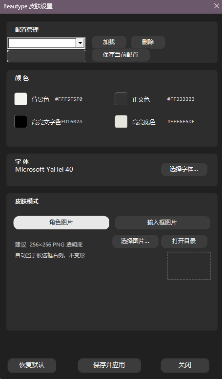
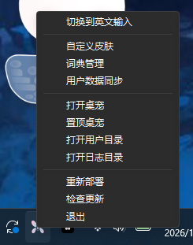
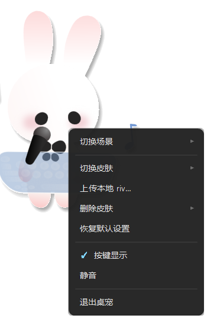

  

# Beautype（敲可爱）

> **一只会陪你打字的桌宠 + 一款长得好看的输入法。** · 开源 · 可上传图片自定义皮肤 · 含打字桌宠

[**中文**](README.md) · [English](README.en.md)

打字是每天最频繁的小事，我希望它也能可爱一点。Beautype 把**输入法**和**桌宠**做成一体：你打字时，桌面上的小宠物会跟着你的节奏动起来；候选框不再是呆板的系统样式，而是可以**上传任意图片、自己设计**的样子。

完全本地运行：不上传数据、无云端依赖、无账号、无遥测。你的输入只留在你的电脑上。

## ✨ 亮点

- **输入法皮肤自由定制** — 不只是换个颜色：可以**上传角色图**、**上传整张输入框图**，或可视化调整字体、字号、圆角、颜色、布局，保存立即生效。
- **桌宠陪你打字** — 内置 Rive 动画桌宠，打字时跟着节奏动起来；悬停、生气、按键提示都有可爱反应。
- **桌宠皮肤库** — 上传本地 `.riv`、随时切换、删除、恢复默认，换一只宠物就是换一种心情。
- **多输入方案** — 全拼、双拼、五笔一键切换（`F4` 方案菜单）。
- **中英界面可切换** — 同一安装包内随时切换中文 / English UI，无需单独下载英文版。
- **隐私友好** — 100% 本地运行，无遥测无账号。

## ⌨ 输入法功能

### 多输入方案
拼音、双拼、五笔按需切换。按 **`F4`**（或 `Ctrl+Shift+1`）打开方案菜单，一键切换下一个方案。

### 皮肤自定义
Beautype 的皮肤系统不是简单的换色，而是一套完整的**自研可视化皮肤编辑器**（设置面板）：

| 模式 | 效果 | 图片规格 |
|---|---|---|
| **角色图** | 普通候选框右侧站一个角色，角色固定不变形 | 256×256 PNG 透明底 |
| **输入框图** | 整个候选窗变成你上传图片的造型（非矩形），候选、上屏、翻页功能不变 | 600×200 PNG（左右各 150px 不变形，中间 300px 拉伸） |
| **默认模式** | 纯色 / 渐变候选框 + 颜色 / 字体 / 字号 / 圆角 / 布局可视化调整 | 无需图片 |

两种图片模式可以叠加或替换：角色图叠加在右侧，输入框图替换整个矩形 UI。**功能链路（候选、上屏、翻页、选词）与皮肤模式无关，只换 UI 样式**——怎么好看怎么来，不影响打字效率。

皮肤上传入口在设置面板，上传后**立即生效、随时切换**；格式与建议尺寸见 `docs/skin-format.md`。

### 快捷键大全

| 快捷键 | 功能 |
|---|---|
| `F4` / `Ctrl+Shift+1` | 打开方案菜单 / 切换到下一个输入方案（拼音·双拼·五笔） |
| `Ctrl+Shift+2` | 中英文输入模式切换 |
| `Ctrl+Shift+3` / `Ctrl+.` | **中英标点切换**（`。，？` ⇄ `. , ?`） |
| `Ctrl+Shift+4` | 简体 / 繁体切换 |
| `Ctrl+Shift+5` | 全角 / 半角切换 |
| `-` / `=`（`+` 同下页） | 候选翻页（对齐雾凇官方，每页 6 个候选） |
| `Space` / 数字键 | 上屏首选 / 选候选 |

> 智能标点：数字后面按句号不会立刻上屏——会先等一下，根据你下一个打的是数字还是别的字符，自动决定输出小数点 `.` 还是句号 `。`。

### 语言栏右键菜单
右键语言栏的 Beautype 图标，即可呼出输入法菜单：

| 菜单项 | 说明 |
|---|---|
| **切换到中文 / 英文输入** | 中英输入模式切换（与 `Ctrl+Shift+2` 等效） |
| **设置** | 打开皮肤 / 参数设置面板 |
| **界面语言** | 子菜单：切换中文 / English 应用界面语言 |
| **词典管理** | 打开用户词典目录 |
| **用户数据同步** | 同步用户配置与词库数据 |
| **打开桌宠** | 启动 / 再开一只桌宠 |
| **置顶桌宠** | 让桌宠始终置顶（被遮挡 / 跑出屏幕时也可拉回） |
| **打开用户目录 / 打开日志目录** | 快速定位配置与日志位置 |
| **重新部署** | 重新部署输入方案数据 |
| **检查更新** | 自动更新入口：从 GitHub Releases 拉取最新版本（含国内镜像兜底） |
| **退出** | 退出输入法 |

### 其他
- 横排候选、每页 6 个候选、`-`/`=` 翻页、数字键选候选
- 中英标点 / 简繁 / 全半角状态**自动记忆**，重启保持上次选择

## 🐰 桌宠功能

内置 Rive 动画桌宠（默认皮肤 beautype_pet.riv），打字时跟着节奏动起来，悬停有反应，按键实时提示（HUD）。

### 桌宠右键菜单

| 菜单项 | 说明 |
|---|---|
| **切换场景** | 子菜单：切换当前皮肤的动画状态（待机、生气等，视皮肤而定），当前场景打勾 |
| **切换皮肤** | 子菜单：默认皮肤 + 你的皮肤库，当前皮肤打勾 |
| **上传本地 riv…** | 从本地选择 `.riv` 文件上传为新皮肤 |
| **删除皮肤** | 子菜单：删除皮肤库中不需要的皮肤 |
| **恢复默认设置** | 恢复默认皮肤 / 位置 / 缩放等全部设置 |
| **按键显示** | 开关：显示/隐藏按键提示 HUD（勾选生效） |
| **静音** | 开关：静音桌宠音效 |
| **退出桌宠** | 退出当前桌宠 |

其他桌宠能力：
- **多开支持**：可以同时开多只桌宠
- **左键拖拽移动**：按住桌宠左键拖动到任意位置，位置自动记忆（重启恢复）
- **滚轮缩放**：鼠标滚轮调整桌宠大小（200–800px）
- **中键单击置顶**：桌宠被其他窗口遮挡时，鼠标中键单击即回到置顶
- **按键 HUD**：打字时显示按键提示，Shift/Ctrl/Alt 等修饰键、标点、数字全覆盖

## 🚀 快速开始

1. 到 **Releases** 页下载最新版安装包（`BeautypeSetup.exe`）
2. 双击安装，重启后即可使用
3. 直接打字体验默认皮肤；**右键语言栏**或**右键桌宠**，开始定制你的输入法和桌宠

> 输入法支持**自动更新**：语言栏右键菜单 → 检查更新。

## 📚 文档

- 架构与设计：`docs/architecture.md`
- 配置说明：`docs/config-schema.md`
- 皮肤格式：`docs/skin-format.md`
- 按键映射 / 协议：`docs/ipc-protocol.md`
- 开发指南：`docs/dev-guide.md`

## 🔨 构建

（面向开发者）输入法：CMake 构建（详见 `docs/dev-guide.md`）；桌宠：`tools/smoke/compile_pet.bat`；打包：NSIS（`packaging/`）。

技术栈：C++ / TSF / Rime（librime）· rive-runtime（D3D11）· NSIS。

## 📄 许可

GPL-3.0（见 `LICENSE`）。第三方许可见 `THIRD-PARTY-NOTICES.md`。

## ⚠️ 免责声明

- 本软件按"原样"提供，不提供任何担保（详见 `LICENSE`，GPL-3.0）。
- 用户上传的皮肤 / 素材版权归上传者或原作者所有，本项目不对用户上传内容负责。
- 软件完全本地运行：无遥测、无数据收集、无账号；键盘钩子仅用于本地按键提示。
- 当前版本安装包未签名，Windows 可能显示"未知发布者"警告。

## 参考

- [weasel（小狼毫）](https://github.com/rime/weasel) · [Rime](https://github.com/rime) · [水杉输入法](https://github.com/metasequoiaime/msime-windows) · [PIME](https://github.com/EasyIME/PIME)
